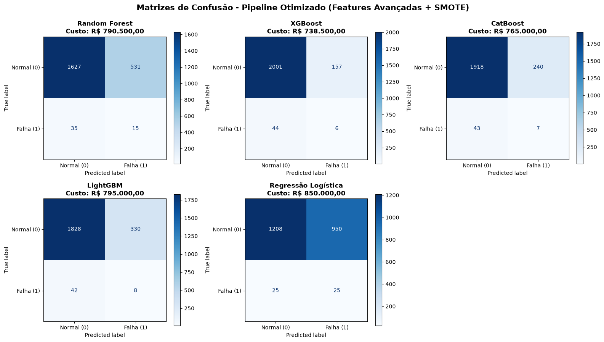

# Otimização de Pipeline MLOps — Manutenção Preditiva Industrial

**Autor:** Pedro Henrique Nunes Zanette
**Disciplina:** Engenharia de Dados e MLOps — Prof. MSc. Hugo Menezes Barra

Atividade prática sobre o pipeline de manutenção preditiva da aula 09: cinco
classificadores (Random Forest, XGBoost, CatBoost, LightGBM e Regressão Logística)
detectam falhas de uma máquina a partir de telemetria sintética de sensores. O
objetivo é encontrar o modelo de **menor custo financeiro** para a TechIndustries
nos três últimos meses de 2025.

```
Custo Total (R$) = (Falsos Negativos × R$ 15.000) + (Falsos Positivos × R$ 500)
```

O relatório completo, com a resposta da Pergunta 1, as tabelas de custo e a
recomendação, está em [`relatorio_final.pdf`](relatorio_final.pdf).

## Como executar

```bash
python3.11 -m venv venv
source venv/bin/activate          # Windows: .\venv\Scripts\Activate.ps1
python -m pip install --upgrade pip
pip install -r requirements.txt

python app_manutencao.py            # Tarefa 1: pipeline base do guia
python app_manutencao_otimizado.py  # Tarefas 2, 3 e 4: pipeline otimizado
```

## Arquivos

| Arquivo | Conteúdo |
|---|---|
| `app_manutencao.py` | Pipeline base do guia (Passos 1 a 6) |
| `app_manutencao_otimizado.py` | Pipeline com as Tarefas 2, 3 e 4 |
| `matriz_comparativa_5_modelos.png` | Matrizes de confusão do pipeline base |
| `matriz_comparativa_otimizada.png` | Matrizes de confusão do pipeline otimizado (features + SMOTE) |
| `print_terminal_tarefa1.png` | Saída no terminal do pipeline base (Tarefa 1) |
| `print_terminal_otimizado.png` | Saída no terminal do pipeline otimizado (Pergunta 1 e custos) |
| `resultados_cenarios.csv` | Métricas e custo dos 5 modelos nos 3 cenários |
| `relatorio_final.pdf` | Relatório final da atividade |

## O que foi feito

- **Tarefa 2 — features temporais:** variação percentual de vibração e pressão,
  máximo e mínimo em janela móvel de 12 h para temperatura e vibração, e a interação
  `temp_x_vibracao`.
- **Tarefa 3 — SMOTE:** reamostragem aplicada **somente** na base de treino (129 → 6.400
  falhas). A base de teste não é tocada, evitando data leakage. Com SMOTE, os pesos de
  classe são desligados para não corrigir o desbalanceamento duas vezes.
- **Tarefa 4 — custo financeiro:** tabela no terminal com Recall, Precisão, FP, FN e
  custo total por modelo, mais duas referências sem modelo (nunca alarmar / sempre alarmar).

Para isolar o efeito de cada mudança, os 5 modelos são treinados em três cenários:
**A** (features base + pesos), **B** (features novas + pesos) e **C** (features novas + SMOTE).

## Resultados (teste: out–dez/2025, 2.208 horas, 50 falhas)

| Modelo | A — Base + Pesos | B — Otimizado + Pesos | C — Otimizado + SMOTE |
|---|---:|---:|---:|
| Random Forest | R$ 849.500 | R$ 788.500 | R$ 790.500 |
| XGBoost | R$ 752.500 | R$ 746.500 | R$ 738.500 |
| CatBoost | R$ 823.500 | R$ 800.500 | R$ 765.000 |
| **LightGBM** | **R$ 717.000** | R$ 780.000 | R$ 795.000 |
| Regressão Logística | R$ 894.000 | R$ 857.500 | R$ 850.000 |
| *Nunca alarmar (sem modelo)* | *R$ 750.000* | *R$ 750.000* | *R$ 750.000* |

- **Pergunta 1:** as novas features não melhoraram o Recall dos boostings
  (XGBoost 2% → 2%, CatBoost 8% → 6%, LightGBM 20% → 12%). Os dados sintéticos não têm
  tendência de degradação e 96% das falhas vêm de ruído aleatório, então features de
  tendência não têm sinal para capturar.
- **SMOTE** aumentou o Recall de quatro dos cinco modelos, mas à custa de mais alarmes
  falsos; o efeito no custo foi misto.
- **Recomendação:** promover o **LightGBM do pipeline base** (R$ 717.000), menor custo
  entre as 15 combinações e R$ 33.000 abaixo de não usar modelo. O melhor do pipeline
  otimizado (XGBoost + SMOTE, R$ 738.500) não supera o modelo atual na métrica de negócio.


